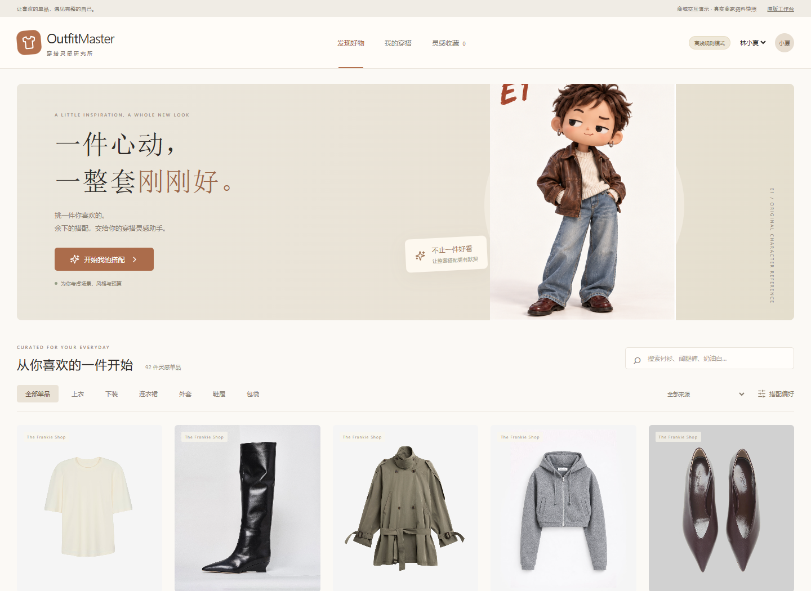
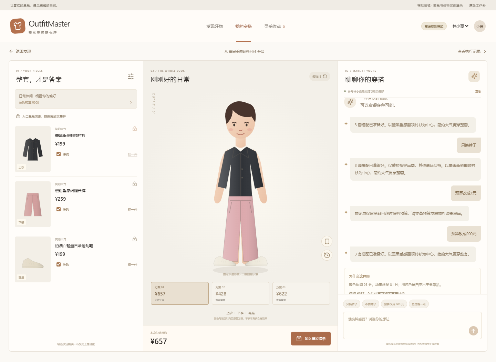

# OutfitMaster · 穿搭推荐 Agent MVP

当前首页是按用户已确认的原版设计恢复的**精选穿搭效果 Demo**：商城 → 独立商品详情 → AI 穿搭工作台。18 件真实商家商品、4 组风格、12 套服饰组合、24 个预生成展示状态，无需模型密钥即可切换。默认长直发方框眼镜，恢复原版「调整 E」弹层；展示图没有 E1 等参考标识。

新增独立「精选衣橱」入口 `/#wardrobe`：按场景、风格和整套预算推荐 12 套搭配，以 AI 形象为封面；`/#set/<id>` 展示同套效果、局部细节及可勾选购买的单品。支持尺码校验、模拟购物袋和确认后的本地订单。详情见 [整套推荐实现记录](docs/wardrobe-sets.md)。

2026-10-15 更新说明、效果覆盖范围与验收见 [原版 Demo 恢复记录](docs/demo-restoration-2026-10-15.md)。`src/App.tsx` 与 `src/styles.css` 原版保留，当前适配在 `src/curated/`；`/#legacy` 查看旧版。此前固定工作流 Agent 和 92 件完整商品快照仍保留在 `/#agent-lab`，继续用于算法与真实模型实验。

2026-10-14已按用户反馈修正真实商品来源和角色身份；原因、修正与视觉验收标准见 [需求纠偏记录](docs/correction-2026-10-14.md)。原工作台仍可通过 `/#legacy` 查看，旧演示数据仅留作历史与回归测试，不进入当前商品库。

## 快速开始

需要 Node.js 24或更高版本。

```sh
npm ci
npm run dev
```

打开 `http://127.0.0.1:5176`。该命令同时启动前端与本地后端；后端默认8787。停止时按Ctrl+C。

生产构建预览：

```sh
npm run build
npm start
```

打开 `http://127.0.0.1:8787`。仅静态托管 `dist/` 时，自动切换到浏览器存储和离线规则模式，不能调用服务端模型。

## 当前效果 Demo

- 原版三栏布局、双列商品卡、整套风格卡、历史箭头、对话、锁定、购买勾选、收藏和规格确认。
- 独立商品详情页支持三张商家原图、原介绍、面料、尺码、USD 原价及人民币估价，AI 入口位于详情页。
- 四组风格：知性通勤、松弛日常、温柔秋日、轻装周末。每组主造型支持四种形象，仅改人物而不改商品。
- 每组另有两套长直发的单件替换款；只开放已有精确效果图的候选。未覆盖的形象明确禁用。
- 图片预载成功后一起切换商品、金额和效果；失败、撤销与历史恢复保留一致状态。
- 当前推荐为有限预设规则与关键词演示；不把预生成图片当作实时 AI 调用。保存和模拟购物记录在浏览器中。

## Agent 实验版本（`/#agent-lab`）

- 模拟电商商城、商品搜索、分类、详情、多图查看与搭配入口。
- 4类场景、5类风格、自动偏好模式、待购预算和可选包袋。
- 92件真实商家商品＋276张原商品照片，保留介绍、品类、面料、SKU/尺码与商品链接。
- 5个模拟用户、96条初始购买/收藏/浏览记录，以及页面新增模拟行为。
- 固定工作流：偏好推断→需求解析→候选筛选→整套束搜索→多维评分→硬约束校验→E效果匹配；缺少效果时可提交独立生成任务。
- 最多3套差异搭配、入口固定、锁定、局部替换、预算冲突处理。
- 可展开的执行记录：实际条件、候选ID、分项评分、校验和耗时。
- 原E1—E4角色切换，保留方圆脸、半眯眼、深棕发色与原头身比例。
- 已缓存一套具体真实商品组合的E1生成样本；其他组合显示商品原图与待生成状态。
- 异步E图像任务：原角色参考＋当前商品图片，按完整商品集合和角色绑定结果；生成后默认待核对。
- 收藏、历史、尺码校验与模拟购物清单；购买勾选不改变形象。
- 本地HTTP API、SQLite持久化、版本冲突与会话并发保护。
- 原前端回归测试、新工作流与接口测试、GitHub Actions。

## 模型与模式

无需密钥即可使用明确标注的**离线规则模式**，支持“只换裤子”“不要裙子”“预算改成500元”“更优雅一点”等常用修改。无法理解的表达会追问，不伪装成任意自然语言理解。

连接真实语言模型：复制 `.env.example` 为 `.env`，设置 `MODEL_API_KEY`、`MODEL_BASE_URL`、`MODEL_NAME`，重启后端。接口兼容千问或DeepSeek的Chat Completions JSON输出；百炼地址以对应地域/工作空间控制台为准，DeepSeek可设置 `MODEL_BASE_URL=https://api.deepseek.com`、`MODEL_NAME=deepseek-chat`。

模型负责对话需求解析；首轮标签推荐和整套评分不依赖模型。未配置真实凭证时，仅测试适配器结构与模拟模型响应，不声称完成真实模型效果评测。密钥只在服务端，`.env`不进入Git。

实时E换装是独立的图像服务：配置 `IMAGE_API_KEY`、`IMAGE_MODEL` 和可选 `IMAGE_BASE_URL`，再重启后端。当前适配Gemini Interactions的多图编辑，配置的模型需支持多图输入与图像输出。内置image_gen已实际生成的样本可直接查看；第三方接口没有真实凭证时不会伪装成可用。点击“生成本套E上身效果”创建异步任务，输出默认待核对，商品或角色变化后不会复用错误效果图。

## 学习与改进

|入口|内容|
|---|---|
|[Harness学习地图](docs/agent-harness.md)|逐步调用链、工具、状态、提示词和实验|
|[审美研究与来源](docs/fashion-research.md)|主要论文、设计依据、数据许可与局限|
|[验收说明](docs/mvp-acceptance.md)|手动路径与自动验证|
|`src/agent/workflow.ts`|推荐主流程、偏好、搜索、整套评分、校验|
|`data/styling-knowledge.json`|实际读取的评分权重与研究公式|
|`server/prompts/intent.md`|可直接修改的系统提示词|
|`server/model.mjs`|模型请求、有限重试、输出校验|
|`src/mvp/Avatar.tsx`|原E参考与严格匹配的商品效果状态|
|`scripts/import-merchant.py`|真实商家资料、原商品照片与价格快照导入|
|`server/render.mjs`|异步多图编辑、缓存和失败状态|
|`server/prompts/e-tryon.md`|原E身份与服饰材质的固定要求|

推荐分数是工程启发式，不是购买概率；没有训练审美模型。真实商品的风格与场景仍有规则粗标，需要校正。E效果采用原角色与商品参考的图像编辑，可能存在纽扣、格纹、衣长或比例偏差，必须人工核对；它不是物理布料模拟或合身预测。当前只有一家商家的样本库，不能称为全面货盘或生产电商系统。

## 数据与检查

```sh
npm test
npm run build
```

数据快照和素材已包含，运行不需要重新下载。重导商家快照：`npm run data:import`，需要Python及网络。来源、照片缓存记录和抓取时间见 `data/merchant-sources/manifest.json`；官网USD价格保留，人民币按固定7.20估算，非实时汇率。研究图片的来源、作者和许可见 `data/sources/fashion-references.json`。旧示例生成脚本只用于历史回归，不进入当前商品库。

SQLite自动保存在 `.runtime/outfit.sqlite`，仅监听本机。演示用户可切换，不属于生产登录与鉴权。收藏在本浏览器；无真实支付或商家订单。

## Git与GitHub

本地Git已初始化，原前端作为基线提交保留。提交中排除了依赖、密钥、数据库、构建和临时截图，文档界面截图单独保留。GitHub上建立空仓库后执行：

```sh
git remote add origin https://github.com/YOUR_ACCOUNT/outfit-master.git
git push -u origin main
```

仓库尚未推送，不需要重新 `git init`。本地包含真实商家资料快照和原照片，保留来源并用于开发验证；大规模真实货盘和公开发布素材需单独管理。

## 界面与验证

[验证记录](docs/validation-report.md)




