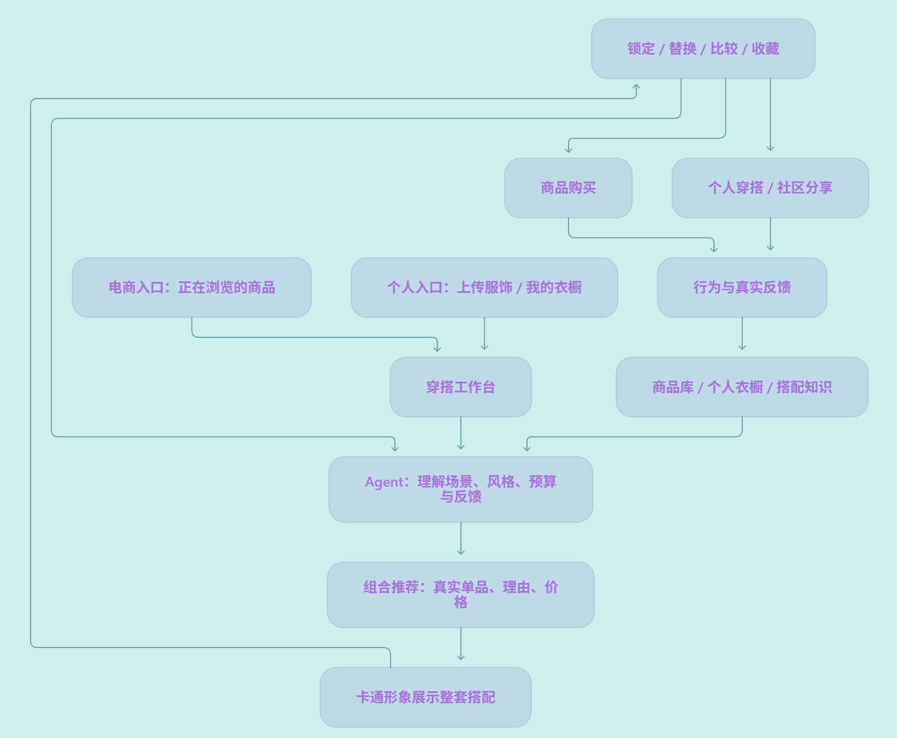

# AI 穿搭产品需求文档 v0\.1 

日期：2026\-09\-29｜状态：开发基线草案

## 1\. 产品定义

从一件服饰出发，推荐可购买的整套搭配，以AI形象呈现整体效果，支持对话调整，带动搭配商品消费。

- 主场景：电商商品页的「帮我搭配」。服务有单品兴趣、缺少搭配思路的消费者；商家是潜在付费方。

- 次场景：从已有衣服出发寻找搭配、管理衣橱、分享真实穿搭反馈。

- 边界：不上传用户人脸，不还原用户身材，不判断尺码与合身程度。AI卡通形象用于表达搭配。

- 核心价值：搭配好看、商品真实可买、调整简单；卡通形象是展示载体。

    

## 2\. 产品全景

|模块|完整需求|所属阶段|
|---|---|---|
|服饰输入|商品导入、上传单件服饰、识别属性、纠正识别结果|MVP 商品导入；上传后续|
|商品与衣橱|商品图片、分类、颜色、材质、风格、价格、库存、链接；个人服饰管理|MVP 商品库；衣橱后续|
|穿搭 Agent|场景/风格/预算理解、组合推荐、解释、锁定与替换、多轮调整、偏好记忆|MVP 基础闭环；记忆后续|
|视觉展示|固定卡通形象、整套预览、商品图对照、方案比较、多种形象|MVP 固定形象；多形象后续|
|电商转化|商品卡、总价、购买跳转、店铺嵌入、库存同步、订单归因|MVP 模拟店铺与跳转；真实接入后续|
|个人穿搭|已有衣服混搭、收藏、历史、按场景找搭配|MVP 收藏与历史；其余后续|
|社区|分享方案与实穿反馈、达人点评、互动、举报及内容管理|后期|
|运营后台|商品维护、搭配评审、反馈处理、模型成本及业务数据|MVP 最小后台|

## 3\. MVP 范围

### 3\.1 默认切口

响应式 Web 应用，模拟一家服饰店铺。暂以女装通勤/日常为样本，商品池约 60—100 件，覆盖上衣、下装、鞋子；根据首家合作商家的货盘调整。使用一个固定卡通形象，不做复杂叠穿和配饰。

### 3\.2 核心流程

1. 用户从商品详情页点击「帮我搭配」，锁定该商品。

2. 选择场景、风格、整套预算；提供默认值，可直接开始。

3. 返回 3 套不同搭配：商品拼图、简短理由、单品价格与总价。

4. 默认生成首套卡通效果，其他方案按需生成；生成期间仍可浏览商品。

5. 用户可锁定单品、替换某一件，或输入「更休闲」「便宜一点」；保留锁定项并刷新搭配及对应效果图。

6. 收藏方案、反馈喜欢/不喜欢及原因，或跳转真实商品链接。无真实链接的样例明确标为演示。

### 3\.3 页面与交付物 

|页面|必须具备|
|---|---|
|模拟店铺 / 商品页|商品列表、详情、搭配入口|
|穿搭工作台|条件输入、3 套方案、卡通预览、商品对照、局部替换、简短对话、购买跳转|
|我的搭配|收藏、历史方案、继续调整；首版使用匿名会话，无跨设备同步|
|简易后台|导入/编辑商品、上下架、查看反馈、请求耗时和费用|

不纳入 MVP：真人试穿、模型训练、3D/动画、完整个人衣橱、社区、支付结算、多平台接入、自动下单。

## 4\. MVP 落地方案

### 4\.1 系统构成

Web 前端 \+ 服务端 API \+ 关系数据库 \+ 图片存储 \+ 异步图片任务 \+ 外部 AI 服务。先采用单体应用，AI 供应商通过独立接口封装，避免绑定单一模型。

核心数据：商品、服饰属性、搭配会话、搭配方案版本、方案商品关联、图片任务、收藏、反馈、行为事件。每张效果图绑定明确的方案版本，避免替换商品后显示旧图。

### 4\.2 推荐与生成链路

|步骤|实现方式与约束|
|---|---|
|商品入库|后台导入图片及商品资料；视觉模型提取分类、颜色、版型等属性，人工校正。价格与库存以商品数据为准|
|需求解析|将用户表达转换为场景、风格、预算、锁定项等结构化条件；预算默认含核心商品|
|候选筛选|先按分类、上下架、预算过滤，再由模型组合和排序；首版不必引入向量数据库|
|方案生成|输出 3 套有区别的组合及简短理由；只能引用候选库中的商品 ID，服务端校验总价和约束|
|图片生成|输入固定形象参考图、所选商品图及构图要求；采用支持多图参考的图像服务，实测后选型|
|多轮修改|更新结构化条件，保留锁定项；新建方案版本并生成对应图片，避免反复改图导致商品逐渐失真|
|异常处理|无合适组合时说明原因，请用户调整条件；图片失败显示商品拼图并允许重试，不伪装为成功|

现有 API 已提供多图输入与图像编辑能力，可作为候选实现基础；卡通形象与多件商品的一致性仍须专项实测。[能力参考：Gemini 官方图像生成文档](https://ai.google.dev/gemini-api/docs/image-generation)

### 4\.3 上线与运营

- 使用有使用授权的商品素材；API 密钥仅在服务端，后台限制访问。

- 部署测试环境和小范围线上环境，配置数据库备份、错误记录、用量上限及单会话生成限额。

- 图片任务设置超时和有限重试；相同商品组合、形象及配置可复用缓存。

- 所有推荐展示真实商品图，效果图标记为 AI 搭配示意；购买前检查商品可售状态。

- 模拟站记录跳转，只有接入商家订单回传后才统计真实购买，不把点击视为成交。

    

## 5\. 验收与验证

以下为首轮暂定目标，不是行业基准；第 1 周根据实测校准并固定。

|维度|验收要求|
|---|---|
|功能闭环|从选商品到推荐、生成、替换、收藏、跳转可完整走通；失败可恢复|
|数据正确|固定验收集中，商品 ID 有效、总价准确、锁定项保留、预算约束满足率 100%；无法满足时明确返回无解|
|视觉可信|固定 30 套样本，经人工对照，至少 80% 无明显颜色、花纹、长短或版型错改；严重失真结果列为失败样本|
|搭配质量|至少 15 名目标用户各完成 3 个真实任务；至少 60% 的任务能从 3 套方案中选出一套愿意采用的搭配|
|性能与成本|初始目标：推荐 P95 ≤15 秒、单套图片 P95 ≤60 秒；记录含失败重试的单次有效会话成本，第 1 周确定费用上限|
|商业验证|MVP 记录搭配曝光、调整、收藏、商品点击；真实试点再看连带购买率、原商品转化、退货及每访客贡献利润|

真实试点随机分流「商家原有搭配」与「AI 可交互搭配」；按实际流量确定样本量，观察完整退货周期后再评价收益。小样本满意度仅用于产品改进。

## 6\. 迭代规划与排期

估算前提：1 名全栈开发为主，产品负责人提供商品素材并参与搭配评审；调用现成 AI 服务。第 1 周从实际启动日计算，MVP 预计 6 周，另留 1—2 周风险缓冲。

|阶段|时间|交付与退出条件|
|---|---|---|
|技术与需求验证|第 1 周|确定样本货盘、卡通风格；完成 30 套生成评测，测耗时/费用；保真度不达标则先调整形象与模型，不直接扩建|
|数据与基础页面|第 2 周|商品库、导入后台、模拟店铺、穿搭工作台框架|
|推荐闭环|第 3 周|条件解析、3 套推荐、约束校验、锁定/替换、商品拼图|
|卡通展示与 Agent|第 4 周|异步生成、多轮调整、版本绑定、缓存、超时与失败处理|
|MVP 联调|第 5 周|收藏历史、反馈埋点、购买跳转、线上测试环境、成本限制|
|小范围上线|第 6 周|用户任务测试、修复、完成 MVP 验收；决定是否进入商家试点|
|商家试点 v0\.2|MVP 通过后约 4 周开发|接入 1 家商家、商品/库存同步、入口嵌入、订单归因；商务接入及效果观察周期另计|
|个人场景 v0\.3|试点复盘后约 4 周|上传单件服饰、识别纠正、轻量衣橱、已有服饰与在售商品混搭、账号同步|
|社区 v1\.0|达到持续使用后另行排期|先上线方案分享与实穿反馈，再决定达人、互动与内容运营范围|

## 7\. 决策节点

- 第 1 周：服饰特征在卡通图中是否保留、成本是否可接受？不通过则缩小品类或调整方案，并重估排期。

- 第 6 周：用户是否认可搭配、愿意继续调整和查看商品？通过后投入真实电商接入。

- 商家试点后：连带消费是否增加，新增收益能否覆盖生成及运营成本？结合结果决定商业化与扩展范围。

    

启动前确认：首批服饰品类、可用商品素材及合作商家、开发人力、月度 AI 预算。未确认项暂按本文默认范围推进设计，不承诺平台接入日期。

